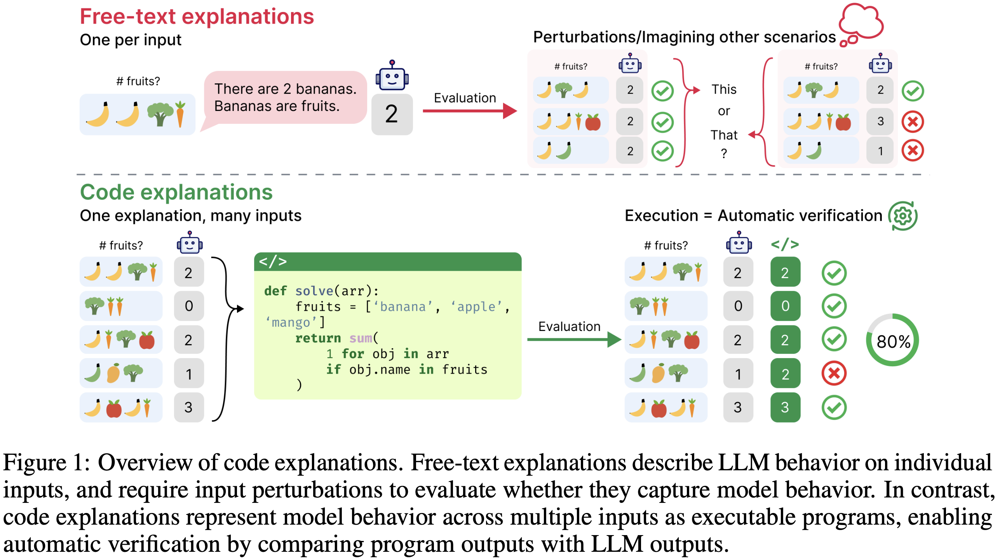

# Code as Explanations: Executable and Verifiable LLM Explanations

<p align="center">
  
</p>

This repository contains the code for *Code as Explanations: Executable and Verifiable LLM Explanations* (ICML 2026). We propose using executable code instead of free-form text as explanations for large language models (LLMs). We introduce **Consistency**, a metric that measures how well a code explanation reproduces a model's behavior across inputs. Code explanations are 6–100× shorter than free-text explanations and achieve higher consistency in several settings, but remain inconsistent on complex language tasks.

> [**Code as Explanations: Executable and Verifiable LLM Explanations**](https://openreview.net/forum?id=jg5HryRQQg)  
> [Nhi Nguyen](https://iam-nhi-nguyen.github.io/), [Shauli Ravfogel](https://shauli-ravfogel.netlify.app/), [Rajesh Ranganath](https://rajesh-lab.github.io/)  
> New York University

## Dependencies

This repository requires Python 3.10. Install the required packages with:

```bash
pip install -r requirements.txt
```

## Quick start

The main evaluation script is `scripts/code_as_explanations.py`. It supports the six main experimental configurations for generating and evaluating code explanations.

All examples below use the `web_of_lies` task from `lukaemon/bbh` and Gemma3-27B as the model to be explained.

### 1. Consistency and Complexity

To return the model's consistency and complexity of its code explanations:

```bash
python scripts/code_as_explanations.py \
  --dataset-name web_of_lies \
  --model-name google/gemma-3-27b-it \
  --num-examples-per-prompt 20 \
  --num-explanations-per-dataset 10 \
  --num-explanations-per-prompt 10 \
  --seed 42
```

This generates multiple code explanations and evaluates their consistency on training and test subsets, along with code complexity metrics.

### 2. Sufficiency

To compute the sufficiency of the model's code and free-text chain-of-thought explanations:

```bash
python scripts/code_as_explanations.py \
  --dataset-name web_of_lies \
  --model-name google/gemma-3-27b-it \
  --compute-sufficiency \
  --seed 42
```

`--compute-sufficiency` computes the sufficiency of both code and free-text explanations by adapting the implementation from Nguyen et al.  [What LLMs Explain Is Not What They Believe](https://openreview.net/forum?id=Z5BE8RFKZk) (2026).

### 3. Hidden states

To return the model's last-token hidden states prior to code explanation generation:

```bash
python scripts/code_as_explanations.py \
  --dataset-name web_of_lies \
  --model-name google/gemma-3-27b-it \
  --return-hidden-states \
  --seed 42
```

`--return-hidden-states` saves the last token's final-layer hidden states for further analysis.

### 4. Separate explainer model

To use a separate model to generate code explanations for the target model:

```bash
python scripts/code_as_explanations.py \
  --dataset-name web_of_lies \
  --model-name google/gemma-3-27b-it \
  --explainer-model-name Qwen/Qwen2.5-Coder-32B-Instruct \
  --seed 42
```

`--model-name` specifies the target model whose behavior is to be explained, while `--explainer-model-name` specifies the model generating code explanations.

### 5. Multi-turn refinement

To iteratively refine code explanations across multiple turns based on their consistency on the training subset:

```bash
python scripts/code_as_explanations.py \
  --dataset-name web_of_lies \
  --model-name google/gemma-3-27b-it \
  --num-refinement-rounds 10 \
  --seed 42
```

`--num-refinement-rounds` specifies the number of refinement turns. At each turn, the model generates new code explanations based on the most consistent explanations from the previous iterations.

### 6. Claude Code agent

To use Claude as an agent to generate code explanations:

```bash
python scripts/code_as_explanations.py \
  --dataset-name web_of_lies \
  --use-claude \
  --model-name claude-opus-5-5 \
  --num-explanations-per-dataset 1 \
  --agent-max-turns 10 \
  --agent-max-budget-usd 1.0 \
  --use-consistency-tool \
  --seed 42
```

`--use-claude` enables the Claude Agent SDK for code generation and execution. The agent can use tools to write and execute code, and iteratively develop explanations. `--agent-max-turns` and `--agent-max-budget-usd` control the maximum number of agent turns and the budget per run, respectively. `--use-consistency-tool` gives the agent access to consistency feedback during refinement.

## Configuration

The main arguments are:

| Argument | Default | Description |
|---|---|---|
| `--dataset-path` | `lukaemon/bbh` | HuggingFace's dataset path |
| `--dataset-name` | `web_of_lies` | HuggingFace's dataset name |
| `--model-name` | `Qwen/Qwen2.5-Coder-32B-Instruct` | Model to be explained |
| `--explainer-model-name` | `None` | (Optional) Separate model to generate explanations |
| `--num-examples-per-prompt` | `20` | Number of examples provided in each code-generation prompt |
| `--num-explanations-per-dataset` | `10` | Number of code explanations generated per dataset |
| `--num-explanations-per-prompt` | `10` | Number of code explanations generated per prompt |
| `--num-refinement-rounds` | `0` | Number of iterative refinement rounds |
| `--return-hidden-states` | `False` | Save last-token hidden states |
| `--compute-sufficiency` | `False` | Compute the sufficiency of code and free-text explanations |
| `--use-claude` | `False` | Use Claude agent |
| `--use-consistency-tool` | `False` | Enable the consistency tool for Claude |
| `--seed` | `42` | Random seed |
| `--result-file` | `data/results.json` | Output results file |

## Outputs

Evaluation results are saved as JSON objects to `data/results.json` by default. Results include model accuracy, code explanations, consistency scores on the training and test subsets, code length, and cyclomatic complexity. Depending on the configuration, additional outputs include sufficiency, hidden states, multi-turn progress, and Claude API costs.

**Reproducing experiments:** The repository provides the core code explanation generation procedure, evaluation pipeline, and metric implementations. All figures and analyses in the paper can be reproduced from the generated results and the experimental details provided in the paper.

## Citation

If you use this code in your research, please cite the following publication:

```bibtex
@inproceedings{nguyen2026code,
  title={Code as Explanations: Executable and Verifiable LLM Explanations},
  author={Nguyen, Nhi and Ravfogel, Shauli and Ranganath, Rajesh},
  booktitle={Conference on Neural Information Processing Systems},
  year={2026}
}
```